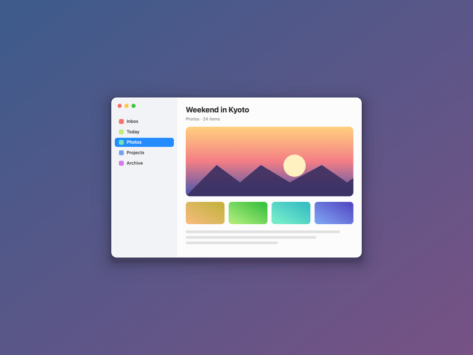

# Exit

**Give every window a proper exit.** Exit is a free, open-source macOS menu-bar app that
plays a GPU animation right where a window closes — it shatters, burns, melts, peels off
like a sticker, gets sucked into your cursor, or turns to dust. Windows can make an
entrance too.

[中文说明](README.zh-CN.md)

## Effects

### Closing effects

<table>
  <tr>
    <td width="50%" valign="top">
      <br>
      <b>Old TV</b><br>
      CRT power-off: collapses to a glowing line, then a dot.
    </td>
    <td width="50%" valign="top">
      <br>
      <b>Pixel Dissolve</b><br>
      The window crumbles into square pixels that lift off in a wave and float away.
    </td>
  </tr>
  <tr>
    <td width="50%" valign="top">
      <br>
      <b>ASCII</b><br>
      The window turns into phosphor-green characters from the edges inward, then rains away column by column.
    </td>
    <td width="50%" valign="top">
      <br>
      <b>Glitch</b><br>
      Digital breakdown: RGB split, torn slices and noise bursts escalate until the signal drops.
    </td>
  </tr>
  <tr>
    <td width="50%" valign="top">
      <br>
      <b>Burn</b><br>
      A ragged line of embers eats the window, leaving a charred edge and rising sparks.
    </td>
    <td width="50%" valign="top">
      <br>
      <b>Black Hole</b><br>
      A singularity opens at the center, twists the window into a spiral and swallows it behind a glowing accretion ring.
    </td>
  </tr>
  <tr>
    <td width="50%" valign="top">
      <br>
      <b>Dust</b><br>
      A sweep turns the window into fine dust that drifts up and away on the wind.
    </td>
    <td width="50%" valign="top">
      <br>
      <b>Shatter</b><br>
      Cracks like glass from the click point; shards tumble and fall away.
    </td>
  </tr>
  <tr>
    <td width="50%" valign="top">
      <br>
      <b>Sticker Peel</b><br>
      Peels up from a corner like a die-cut sticker, then the whole sticker lifts away.
    </td>
    <td width="50%" valign="top">
      <br>
      <b>Confetti</b><br>
      The window pops and bursts into a shower of fluttering paper confetti.
    </td>
  </tr>
  <tr>
    <td width="50%" valign="top">
      <br>
      <b>Melt</b><br>
      Melts like warm wax: the bottom edge sags into glossy drips that run down and away.
    </td>
    <td width="50%" valign="top">
      <br>
      <b>Vacuum</b><br>
      Sucked into the spot you clicked, swirling down to a point.
    </td>
  </tr>
</table>

### Opening effects

<table>
  <tr>
    <td width="50%" valign="top">
      <br>
      <b>Glint</b><br>
      A sheet of light sweeps across the new window as its edge glows in your accent color.
    </td>
    <td width="50%" valign="top">
      <br>
      <b>Sparkle</b><br>
      A new window arrives with twinkling stars along its edges and a soft ring of light.
    </td>
  </tr>
</table>

## Highlights

- **14 built-in effects**, rendered with Metal at your display's refresh rate:
  Old TV, Pixel Dissolve, ASCII, Glitch, Burn, Black Hole, Dust, Shatter, Sticker Peel,
  Confetti, Melt, Vacuum — plus Glint and Sparkle for windows that open.
- **The true last frame.** When you press ⌘W / ⌘Q / ⌘M or click a window's close button,
  Exit holds the input for a few milliseconds, photographs the window as it is, then lets
  it go. The animation starts from exactly what you saw — no stale picture, no grey box.
- **More than closing.** Assign effects separately to closing a window, quitting an app,
  opening a window and minimizing. Pick one, shuffle, or turn any of them off.
- **Effects are just files.** Each effect is one Metal shader in
  `~/Library/Application Support/Exit/Effects/`. Edit it and it recompiles the moment you
  save. Share it by sending the file. See the [authoring guide](docs/EFFECTS.md).
- **An effect market.** Settings → Market lists effects made by other Exit users
  ([browse them on the web](https://kadaliao.github.io/exit-effects/)). Try one on screen,
  install it, and it stays up to date; or subscribe and new effects arrive by themselves.
  Made one you like? Ask your coding agent to submit it: `Exit --market submit` checks it
  and sends it to [exit-effects](https://github.com/kadaliao/exit-effects), where a bot
  renders a preview and opens a pull request ([guide for agents](https://github.com/kadaliao/exit-effects/blob/main/AGENTS.md)).
- **Describe an effect, get an effect.** Type "the window pops like a balloon" and an AI
  model writes the shader. Exit compiles it, renders test frames to check it starts
  seamlessly, ends cleanly and runs fast, sends any problems back to the model, and plays
  the result. Use a coding CLI you're already signed in to (Claude Code, Codex, Gemini CLI,
  OpenCode or Pi), or your own API key for Anthropic, OpenAI, Gemini, OpenRouter, DeepSeek,
  Kimi, Qwen, GLM, or any OpenAI- or Anthropic-compatible endpoint, including local Ollama.
- **Stays out of the way.** Click-through overlays that never take focus, multiple
  displays, Spaces, full-screen apps, per-app exclusions, minimum window size, and it goes
  still when Reduce Motion is on.

## Install

Requires macOS 14 or later (Apple Silicon and Intel).

```sh
brew install --cask kadaliao/tap/exit
```

Or download the DMG from [Releases](https://github.com/kadaliao/exit/releases/latest).

Or build it yourself:

```sh
git clone https://github.com/kadaliao/exit && cd exit
scripts/build-app.sh
open build/Exit.app
```

## Permissions

| Permission | Why |
|---|---|
| Accessibility (required) | To notice windows opening, closing and minimizing, and to briefly hold ⌘W / ⌘Q / ⌘M and close-button clicks for the precise last frame. Only those shortcuts are examined; every other key passes straight through. |
| Screen Recording (optional) | So the animation starts from the window's real picture. Without it Exit animates a card with the app's icon. |

Window pictures live in memory for a few seconds and are never written to disk or sent
anywhere. Exit makes network requests only when you generate an effect with AI, and for
the effect market: when you open Settings → Market, and every few hours if you have
installed market effects (to update them) or subscribed to new ones. Those requests just
download the market's public `index.json` and effect files; nothing about you is sent.

## Making effects

```metal
// @name Fade Away
// @name.zh 淡出
// @duration 0.35
// @events close, quit, minimize

float4 effect(float2 p, constant Exit& u, texture2d<float> tex) {
    float t = easeInCubic(u.progress);
    float2 c = windowCenter(u);
    return sampleWindow(tex, u, c + (p - c) / (1.0 - 0.08 * t)) * (1.0 - t);
}
```

Save that as `fade-away.metal` in the Effects folder and it's in the menu. The
[guide](docs/EFFECTS.md) covers the uniforms, the helper library and the rules that make
an effect feel right. Command-line tools for authors:

```sh
Exit.app/Contents/MacOS/Exit --check                       # compile everything
Exit.app/Contents/MacOS/Exit --validate --only my-effect   # seamless start, clean end, speed
Exit.app/Contents/MacOS/Exit --render-sheet out.png --only my-effect
Exit.app/Contents/MacOS/Exit --bench
Exit.app/Contents/MacOS/Exit --market list                 # also: install ID, uninstall ID
Exit.app/Contents/MacOS/Exit --market submit my-effect --wait   # send it to the market (needs gh)
```

Add `--effects-dir DIR` to test the files in a folder without your own effects in the way.

## How it works

- `WindowTracker` follows every app's windows through Accessibility notifications on its
  own thread, so a hung app can't stall anything.
- `EventInterceptor` is a session event tap that only looks at ⌘W / ⌘Q / ⌘M and clicks
  on traffic-light buttons, holding them until `SnapshotService` (ScreenCaptureKit) has the
  frame or 160 ms pass.
- `OverlayPanel` is a click-through, non-activating panel with a Metal layer, drawn
  above where the window was. A small pool is kept warm so the first frame lands
  immediately.
- Effects are compiled from source at runtime (`device.makeLibrary(source:)`), which is
  what makes hot reload and AI generation possible.

## License

MIT
