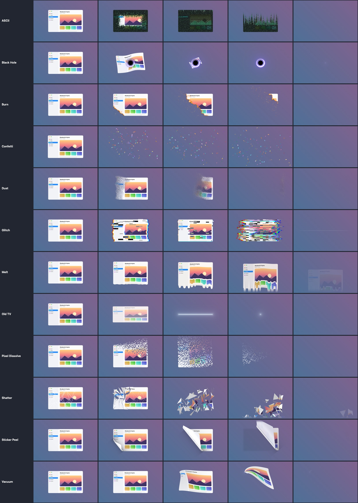

# Exit

**给每个窗口一个体面的退场。** Exit 是一个免费开源的 macOS 菜单栏应用：窗口关闭时，
在它原来的位置播放一段 GPU 动画——碎成玻璃、烧成灰烬、融化滴落、像贴纸一样被撕下、
被光标吸走，或者化成尘埃。窗口打开时也可以有登场效果。

## 亮点

- **14 个内置特效**，Metal 渲染，跟随屏幕刷新率：老电视、像素消散、ASCII、故障、燃烧、
  黑洞、灰飞烟灭、玻璃碎裂、贴纸撕下、彩纸礼花、融化、吸入光标，以及用于窗口打开的
  流光、星光。
- **真实的最后一帧。** 按下 ⌘W / ⌘Q / ⌘M 或点击关闭按钮时，Exit 先把输入停留几毫秒，
  拍下窗口此刻的样子再放行。动画从你看到的画面开始，不会用旧截图，也不会是灰色占位。
- **不只是关闭。** 关闭窗口、退出 App、打开窗口、最小化可以分别指定特效：固定一个、
  随机，或者关掉。
- **特效就是文件。** 每个特效是 `~/Library/Application Support/Exit/Effects/` 里的一个
  Metal 着色器文件，保存即重新编译，发文件就能分享。写法见[编写指南](docs/EFFECTS.md)。
- **一句话生成特效。** 输入“窗口像气球一样被戳破”，Claude 写出着色器；Exit 编译后渲染
  测试帧，自动检查开头是否无缝衔接、结尾是否干净、速度够不够快，有问题就反馈给 Claude
  修改，最后直接播放给你看。可以用本机的 Claude Code 登录，也可以填 Anthropic API Key。
- **不打扰。** 叠加层可点穿、不抢焦点；支持多显示器、多桌面空间、全屏 App；可按 App
  排除、设置最小窗口尺寸；开启“减弱动态效果”时自动不播放。



## 安装

需要 macOS 14 或更高版本（Apple Silicon 和 Intel 都支持）。

```sh
brew install --cask kadaliao/tap/exit
```

也可以在 [Releases](https://github.com/kadaliao/exit/releases/latest) 下载 DMG。

或者自己编译：

```sh
git clone https://github.com/kadaliao/exit && cd exit
scripts/build-app.sh
open build/Exit.app
```

## 权限

| 权限 | 用途 |
|---|---|
| 辅助功能（必需） | 感知窗口的打开、关闭、最小化；在 ⌘W / ⌘Q / ⌘M 和点击关闭按钮时短暂停留，拍下最后一帧。只检查这几个快捷键，其他按键原样放行。 |
| 录屏（可选） | 让动画从窗口的真实画面开始。没有这个权限时，会用带 App 图标的卡片代替。 |

窗口画面只在内存里停留几秒，不会写入磁盘，也不会发送到任何地方。除了你主动用 Claude
生成特效，Exit 不发起任何网络请求。

## 写特效

见 [docs/EFFECTS.md](docs/EFFECTS.md)。命令行工具：

```sh
Exit.app/Contents/MacOS/Exit --check                       # 编译全部特效
Exit.app/Contents/MacOS/Exit --validate --only my-effect   # 检查无缝开头、干净结尾、性能
Exit.app/Contents/MacOS/Exit --render-sheet out.png --only my-effect
```

## 许可

MIT
