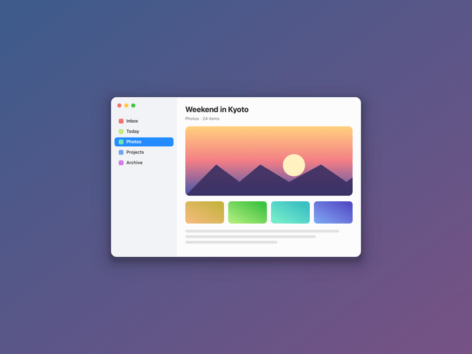

# Exit

**给每个窗口一个体面的退场。** Exit 是一个免费开源的 macOS 菜单栏应用：窗口关闭时，
在它原来的位置播放一段 GPU 动画——碎成玻璃、烧成灰烬、融化滴落、像贴纸一样被撕下、
被光标吸走，或者化成尘埃。窗口打开时也可以有登场效果。

**官网：[kadaliao.github.io/exit](https://kadaliao.github.io/exit/)** · [English](README.md)

## 亮点

- **14 个内置特效**，Metal 渲染，跟随屏幕刷新率：老电视、像素消散、字符矩阵、故障、燃烧、
  黑洞、灰飞烟灭、玻璃碎裂、贴纸撕下、彩纸礼花、融化、吸入光标，以及用于窗口打开的
  流光、星光。
- **真实的最后一帧。** 按下 ⌘W / ⌘Q / ⌘M 或点击关闭按钮时，Exit 先把输入停留几毫秒，
  拍下窗口此刻的样子再放行。动画从你看到的画面开始，不会用旧截图，也不会是灰色占位。
- **不只是关闭。** 关闭窗口、退出 App、打开窗口、最小化可以分别指定特效：固定一个、
  随机，或者关掉。
- **特效就是文件。** 每个特效是 `~/Library/Application Support/Exit/Effects/` 里的一个
  Metal 着色器文件，保存即重新编译，发文件就能分享。写法见[编写指南](docs/EFFECTS.zh-CN.md)。
- **特效市场。** “设置 → 特效市场”里是其他 Exit 用户做的特效（也可以[在网页上浏览](https://kadaliao.github.io/exit-effects/)）。
  先在屏幕上试玩，喜欢就安装，之后会自动更新；也可以订阅，新上架的特效自动装上。
  自己写的或 AI 生成的特效满意了，在它的卡片上点「投稿」：Exit 检查特效，用你的 GitHub
  账号发到 [exit-effects](https://github.com/kadaliao/exit-effects)，机器人渲染预览后自动
  提交 PR，结果直接显示在 Exit 里。第一次用 GitHub 登录一下就行，已经登录了 GitHub CLI
  的话连这步都省了。coding agent 也可以用 `Exit --market submit` 投稿
  （[agent 投稿指南](https://github.com/kadaliao/exit-effects/blob/main/AGENTS.md)）。
- **自动更新。** Exit 每天查一次 GitHub Releases，在后台下载新版本，校验签名和公证，
  等你离开电脑一会儿（或退出 Exit 时）装上。两步都可以在“设置 → 通用”里关掉，菜单里
  也有“检查更新…”。
- **一句话生成特效。** 输入“窗口像气球一样被戳破”，AI 模型写出着色器；Exit 编译后渲染
  测试帧，自动检查开头是否无缝衔接、结尾是否干净、速度够不够快，有问题就反馈给模型
  修改，最后直接播放给你看。可以直接用本机已登录的 Claude Code、Codex、Gemini CLI、
  OpenCode 或 Pi，也可以填自己的 API Key：Anthropic、OpenAI、Gemini、OpenRouter、DeepSeek、
  Kimi、通义千问、智谱 GLM，或任何 OpenAI / Anthropic 兼容的服务（包括本地 Ollama）。
- **不打扰。** 叠加层可点穿、不抢焦点；支持多显示器、多桌面空间、全屏 App；可按 App
  排除、设置最小窗口尺寸；开启“减弱动态效果”时自动不播放。

## 特效

### 退场特效

<table>
  <tr>
    <td width="50%" valign="top">
      <br>
      <b>老电视</b><br>
      显像管关机：压成一道亮线，再缩成一个光点。
    </td>
    <td width="50%" valign="top">
      <br>
      <b>像素消散</b><br>
      窗口碎成方块像素，像波浪一样一块块飘起、缩小、消散。
    </td>
  </tr>
  <tr>
    <td width="50%" valign="top">
      <br>
      <b>字符矩阵</b><br>
      窗口从四周向内变成荧光绿字符，再像字符雨一样一列列落下消失。
    </td>
    <td width="50%" valign="top">
      <br>
      <b>故障</b><br>
      数字信号崩坏：RGB 分离、画面撕裂、噪点爆发越来越强，最后信号中断。
    </td>
  </tr>
  <tr>
    <td width="50%" valign="top">
      <br>
      <b>燃烧</b><br>
      一道参差的火线烧过窗口，留下焦黑的边缘和向上飘的火星。
    </td>
    <td width="50%" valign="top">
      <br>
      <b>黑洞</b><br>
      窗口中心裂开一个奇点，把窗口拧成漩涡吞进去，吸积环闪耀后坍缩消失。
    </td>
  </tr>
  <tr>
    <td width="50%" valign="top">
      <br>
      <b>灰飞烟灭</b><br>
      窗口从一侧开始化成细小的灰烬，被风吹散、飘向远处。
    </td>
    <td width="50%" valign="top">
      <br>
      <b>玻璃碎裂</b><br>
      从点击处像玻璃一样裂开，碎片翻滚着坠落。
    </td>
  </tr>
  <tr>
    <td width="50%" valign="top">
      <br>
      <b>贴纸撕下</b><br>
      像一张贴纸那样从一角卷起，随后整张被揭起拿走。
    </td>
    <td width="50%" valign="top">
      <br>
      <b>彩纸礼花</b><br>
      窗口“啵”地一下炸成漫天飘落的彩色纸屑。
    </td>
  </tr>
  <tr>
    <td width="50%" valign="top">
      <br>
      <b>融化</b><br>
      像受热的蜡一样融化：底边垂成一道道发亮的蜡滴，往下流走。
    </td>
    <td width="50%" valign="top">
      <br>
      <b>吸入光标</b><br>
      被吸进你点击的位置，打着旋缩成一个点。
    </td>
  </tr>
</table>

### 登场特效

<table>
  <tr>
    <td width="50%" valign="top">
      <br>
      <b>流光</b><br>
      一道光扫过新窗口，边缘以系统强调色微微亮起。
    </td>
    <td width="50%" valign="top">
      <br>
      <b>星光</b><br>
      新窗口出现时，边缘闪起点点星光，并荡开一圈柔和的光环。
    </td>
  </tr>
</table>

## 安装

需要 macOS 14 或更高版本（Apple Silicon 和 Intel 都支持）。

```sh
brew install --cask kadaliao/tap/exit
```

也可以在[官网](https://kadaliao.github.io/exit/#download)或 [Releases](https://github.com/kadaliao/exit/releases/latest) 下载 DMG。

或者自己编译：

```sh
git clone https://github.com/kadaliao/exit && cd exit
scripts/build-app.sh
open build/Exit.app
```

## 权限

| 权限 | 用途 |
|---|---|
| 辅助功能（必需） | 感知窗口的打开、关闭、最小化；在 ⌘W / ⌘Q / ⌘M 和点击关闭按钮时短暂停留，拍下最后一帧。只检查这几个快捷键，其他按键原样放行。 |
| 录屏（可选） | 让动画从窗口的真实画面开始。没有这个权限时，会用带 App 图标的卡片代替。 |

窗口画面只在内存里停留几秒，不会写入磁盘，也不会发送到任何地方。Exit 只在这几种情况下
联网：你用 AI 生成特效时；每天向 GitHub 查一次最新版本（有新版本时下载）；以及特效
市场——打开“设置 → 特效市场”时，或者装了市场特效（为了更新）、订阅了新特效时每隔几
小时检查一次。这些请求只是下载公开文件，不会发送任何关于你的信息。只有你点「投稿」时，
特效才会以你的 GitHub 账号发成一个公开 issue；Exit 的 GitHub 登录只能读写特效市场仓库
的 issue，令牌保存在登录钥匙串里。

## 写特效

见 [docs/EFFECTS.zh-CN.md](docs/EFFECTS.zh-CN.md)。命令行工具：

```sh
Exit.app/Contents/MacOS/Exit --check                       # 编译全部特效
Exit.app/Contents/MacOS/Exit --validate --only my-effect   # 检查无缝开头、干净结尾、性能
Exit.app/Contents/MacOS/Exit --render-sheet out.png --only my-effect
Exit.app/Contents/MacOS/Exit --market list                 # 还有 install ID、uninstall ID
Exit.app/Contents/MacOS/Exit --market submit my-effect --wait   # 投稿到特效市场
Exit.app/Contents/MacOS/Exit --update                      # 立即更新（--check 只检查）
```

加上 `--effects-dir 目录` 可以只测试那个目录里的文件，不受你自己的特效干扰。

## 许可

MIT
